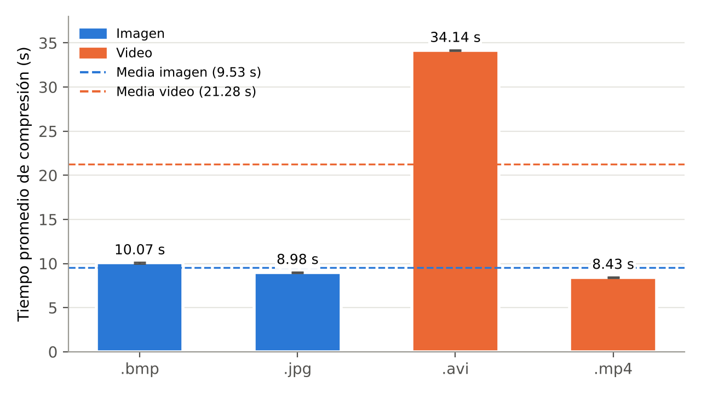
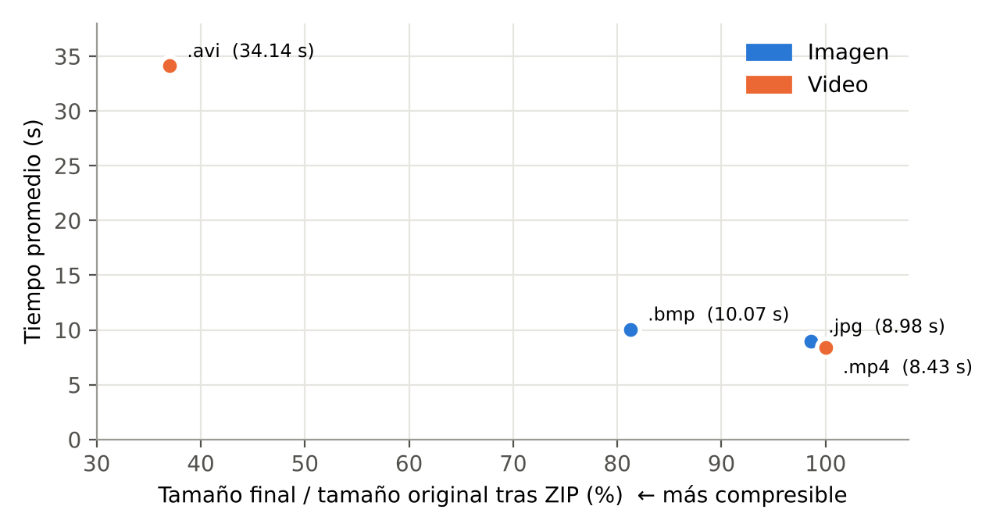

# Análisis experimental del tiempo de compresión en archivos digitales de imagen y video

**¿Qué tarda más en comprimirse: una imagen o un video?** Lo medimos 80 veces en condiciones controladas. La respuesta fue sí… y también no.

[](https://JulioCSGR1234.github.io/compresion-imagen-video-itcuv/)
[](informe/Practica3_Analisis_Compresion_UV.pdf)
[](datos/crudos/mediciones_80.csv)

Universidad Veracruzana · Facultad de Ingeniería en Electrónica y Comunicaciones · Región Poza Rica-Tuxpan
Ingeniería en Tecnologías Computacionales · Experiencia educativa: *Investigación Aplicada a Tecnologías Computacionales* · Periodo agosto 2026 – enero 2027

---

## Resumen

Comprimimos cuatro archivos de tamaño casi idéntico (~40 MiB), dos de imagen y dos de video, con el mismo software (7-Zip 26.06), el mismo algoritmo (DEFLATE, nivel máximo) y en la misma computadora, repitiendo cada medición 20 veces. Las 80 mediciones fueron muy estables (coeficiente de variación < 1.1 %).

En promedio, el video tardó **21.28 s** y la imagen **9.53 s**. La prueba t de Welch confirma que la diferencia es significativa (**t = −5.71; gl = 39.1; p = 1.31 × 10⁻⁶**), así que **la hipótesis de investigación es VERDADERA**.

El desglose por archivo matiza ese resultado: el video sin compresión (.avi) fue el más lento, pero el video H.264 (.mp4) fue **el más rápido de los cuatro**. Lo que ordena los tiempos no es "imagen contra video", sino **cuánto puede comprimirse el archivo** (r = −0.97).

## Resultados

| Archivo | Tipo | Media (s) | Desv. estándar (s) | CV | Tamaño tras ZIP | Velocidad |
|---|---|---:|---:|---:|---:|---:|
| `.bmp` | Imagen | 10.0727 | 0.1023 | 1.02 % | 81.26 % | 3.89 MiB/s |
| `.jpg` | Imagen | 8.9793 | 0.0611 | 0.68 % | 98.59 % | 4.51 MiB/s |
| `.avi` | Video | 34.1394 | 0.0740 | 0.22 % | 37.01 % | 1.17 MiB/s |
| `.mp4` | Video | 8.4275 | 0.0765 | 0.91 % | 99.99 % | 4.79 MiB/s |

<p align="center">
  
  
</p>

**¿Por qué ganó un video?** DEFLATE busca secuencias repetidas. Un video sin comprimir está lleno de ellas y, al nivel máximo, el algoritmo las examina todas: tarda. Un `.mp4` o un `.jpg` ya pasaron por un compresor; sus datos parecen ruido, casi no hay coincidencias que evaluar y el algoritmo termina rápido, aunque casi no reduzca el tamaño.

**Consecuencia práctica:** comprimir con ZIP archivos `.jpg` o `.mp4` gasta tiempo de procesador sin ahorrar espacio; conviene empaquetarlos en modo "almacenar". Los formatos sin compresión previa (`.bmp`, `.avi`, `.wav`) son los que sí justifican el costo.

## Contenido del repositorio

```
compresion-imagen-video-itcuv/
├── docs/                  Página web de divulgación (se publica con GitHub Pages)
│   ├── index.html
│   └── descargas/         PDF del informe y Excel con los datos, enlazados desde la página
├── informe/               Informe de la Práctica 3 (Word y PDF, plantilla UV)
├── datos/
│   ├── crudos/            Las 80 mediciones y la prueba piloto, tal como salieron del script
│   └── procesados/        Estadísticas generadas por scripts/analisis/analisis.py
├── hojas-captura/         Plantilla de captura y hojas con los datos reales (Excel)
├── scripts/
│   ├── medicion/          Script de medición para Windows (PowerShell) y Linux (Bash)
│   └── analisis/          Script de análisis estadístico y gráficas (Python)
├── graficas/              Gráficas usadas en el informe
├── muestra/               Huellas SHA-256 de los 4 archivos de prueba (los archivos van en el Release)
└── documentacion/         Metodología, diccionario de datos y guía para reproducir el experimento
```

## Reproducir el análisis

Desde la raíz del repositorio, con Python 3.10 o superior:

```bash
pip install -r scripts/analisis/requirements.txt
python scripts/analisis/analisis.py
```

El script lee `datos/crudos/mediciones_80.csv`, recalcula todas las estadísticas del informe y vuelve a generar las gráficas. Para repetir **las mediciones** en otra computadora, sigue [documentacion/REPRODUCIR.md](documentacion/REPRODUCIR.md).

## Documentación

- [Metodología y condiciones experimentales](documentacion/METODOLOGIA.md)
- [Diccionario de datos](documentacion/DICCIONARIO_DATOS.md)
- [Cómo reproducir el experimento](documentacion/REPRODUCIR.md)
- [Archivos de la muestra y verificación](muestra/README.md)

## Equipo

| Integrante | Matrícula |
|---|---|
| Julio César Gómez Cuellar | S25032182 |
| Miriam Naomi Cruz Cruz | S25007104 |
| Alejandro de Jesús Ramírez López | zS25007111 |

**Facilitador:** Dr. Alfredo Cristóbal Salas, Facultad de Ingeniería en Electrónica y Comunicaciones, UV.

## Uso de inteligencia artificial

El análisis estadístico, los scripts y la redacción se apoyaron en Claude (Anthropic), bajo revisión y responsabilidad del equipo. Los datos son mediciones reales obtenidas el 14 de noviembre de 2026.

## Licencia

El código (`scripts/`, `docs/index.html`) se distribuye bajo licencia [MIT](LICENSE). Los datos, gráficas e informe se comparten bajo [CC BY 4.0](https://creativecommons.org/licenses/by/4.0/deed.es): puedes reutilizarlos citando al equipo. Los elementos de identidad de la Universidad Veracruzana (logotipo, pleca, lema) son patrimonio universitario y no están cubiertos por estas licencias.

Para citar este trabajo, usa el botón **"Cite this repository"** de GitHub (lee [CITATION.cff](CITATION.cff)).
